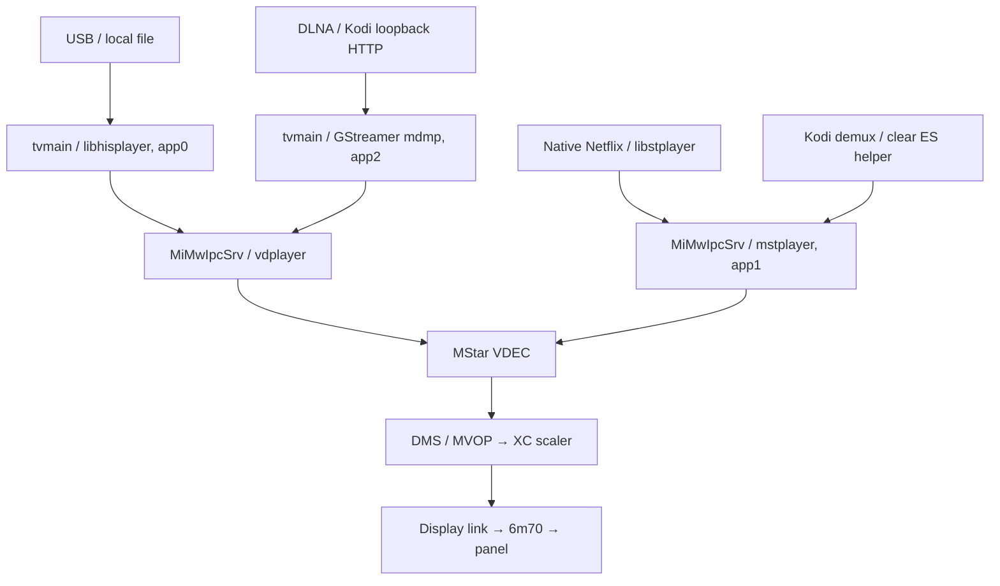

# Native players, firmware profiles and cadence

This investigation used a Hisense 55U8QF, VIDAA U4 `V0000.01.00C.P0219` and kernel
`4.9.44`. Playback observations, static inspection and inferences are identified below.

## The decoder paths

Cobalt and Kodi draw their interfaces in the separate DirectFB/GOP graphics plane.
The video path uses the SoC decoder and the scaler. [TV architecture](01-hisense-architecture.md)

| Caller or source | Player route | Evidence |
| --- | --- | --- |
| TV USB player and local `file://` DMP | `tvmain` opens the local item with `libhisplayer`. App type 0 selects `[app0]` and the `vdplayer` branch. | Static call path, local playback measured. |
| DLNA and Kodi's DMP HTTP fallback | `tvmain` opens a GStreamer `playbin2` pipeline. The vendor `mdmp` element receives app-type hint 2 for `[app2]`. This also takes the file-player branch. | Static call path, HTTP playback measured. |
| Netflix | `libstplayer` creates a packet-fed item with app type 1. `[app1]` enables `MultiDecode`, sets initial pause and leaves the output rate content-led. The corresponding branch is `mstplayer` in `libmmp`. | Item and profile from static inspection. Native film cadence measured. |
| YouTube | Cobalt exposes the Starboard player boundary. `[yttv2018]` and `[app9]` enable `MultiDecode` and specify `60000`. | Static configuration predicts 60 Hz on this route. Live cadence remains open. |
| Prime Video | `[Amazon_AVP]` enables `MultiDecode` without a fixed rate. | Static configuration and a qualitative project observation. A separate repeatable trace remains open. |
| Browser engine and HbbTV | `[OpenBrowser]`, `[HbbTV]` and `[Sraf-DASH]` enable `MultiDecode`. `[Sraf-MSE]` specifies `60000`. | Static configuration. Live cadence remains open. |
| Cast | `[CastTV]` configures frame-rate adjustment. In the SDK code the corresponding helper returns `60000`. | Static inspection. The live client remains unidentified. |

`MultiDecode` selects the vendor branch in this firmware configuration. Our tests
exercised one main playback owner at a time. A photo screensaver or a paused app can
hold the media service, so the launcher releases its own native session before
starting the next owner. Kodi's isolated ES helper owns its own item and tears it down
before the normal TV workflow resumes.

## What “player account” meant in the investigation

| Identity | Purpose |
| --- | --- |
| Linux process account | `tvmain`, the media service, the launcher and the native apps have distinct device accounts. On the DMP route Kodi's HTTP feeder verifies the stock player account `tvmain` (UID `2910` on this firmware) and a per-run URL token before serving the media. |
| Firmware media profile | `libmmsdk` picks the configuration when a media item is created. The app type in `ST_MEDIA_INFO +0xa4` is part of item setup. For instance, the helper uses the clear ES configuration observed under `[app1]`. |
| Playback session | `getMpCtrlStat()[0]` identifies the current DMP session. The launcher checks the source and owner before claiming or releasing a session. A session that belongs to another app is left to its owner. |

The caller-identity experiments produced no positive cadence change. The local DMP item
and the HTTP DMP item used different profiles and both kept the same 59.94 Hz family
for the tested film clips. The last `PlayMedia` argument `Media` is an owner tag in the
launcher protocol. It belongs to source and session management. The media profile comes
from the item configuration.

## Why observing Netflix led to the clear ES client

In the native Netflix app, the menu lacked the video playback IRQ, a trailer produced
about 30 interrupts/s and a 23.976p film produced 23.980/s. This showed that the same
hardware could run at the film cadence. DMP still chose the 59.94 Hz family with both local
and HTTP test clips.

Inspection of `libstplayer` revealed the useful sequence for a clear-stream client.
`MM_Initialize()` establishes the service connection. `MM_CreateMediaItem` receives codec
attributes and frame timing for a packet-fed item. The rational frame rate becomes
millihertz at `ST_MEDIA_INFO +0x5c`. For example, `24000/1001` produces `23976` and `24/1`
produces `24000`. The helper supplies timestamped compressed access units and waits
for `INIT_OK` after preroll before invoking `MM_Play`.

Kodi reproduces that clear media sequence in its own process arrangement.
`CTVPlayer::StartEs` fills the codec and rate, `CTVEsEngine` sends `fps_mhz` to the local
ARM helper, and `flex_es_helper.c` writes it into the 0x1b0-byte vendor descriptor.
Kodi demuxes the file. The helper delivers access units to the TV service, maintains
decode order and PTS and keeps the data queue fed. For H.264 and HEVC it uses Annex B
and in-band parameter sets. Payload bytes are passed once through the intended
data descriptor. [Decoder lab and packet layout](02-hardware-decoder.md)

The file-player SDK contains a 50/60 Hz choice. One framebuffer-less branch in static
analysis converts near 24p into the 60 Hz family using a 5:2 ratio. Its activation in
the tests is inferred from the matching cadence. With the ES item the frame information
propagates through the vsync bridge to MVOP/DMS when the selected profile leaves timing
content-led. Editing timestamps alone in a container did not change the source rate for
the tested HEVC and VC-1 streams, because their VUI or sequence headers still gave the
original rate.

## What was measured

| Reference run | Video-path IRQ 51 | Scaler `Vfreq` |
| --- | --- | --- |
| Home or Netflix menu | No video IRQ increment | Netflix menu displayed 300 |
| Native Netflix trailer | 28.5–30.1/s | 300 |
| Native Netflix 23.976p film | 23.980/s | 239 |
| DMP 23.976/24p, local and HTTP | 59.94–60.2/s | 239 or 599 depending on stage |
| DMP 25p / 50p | About 50/s | 500 on the corresponding samples |
| Standalone clear ES, 23.976p | 23.970/s | 239 |
| Standalone clear ES, exact 24p | 23.998/s across 120 s | 240 |

`irq24.sh` sums IRQ counters across cores and divides by elapsed `/proc/uptime`.
On the reference kernel IRQ 51 followed the video route, with MVOP as the working
interpretation. Scaler `Vfreq` gives the input timing in tenths of a hertz and can
describe the source rate while DMP outputs a different cadence. IRQ 52 is GOP/local
dimming and stayed near 120/s in both 60 Hz and 24p cases. It supplies no direct
measurement of the physical panel behind the 6m70.

For a new test capture the same clear clip in DMP and ES, measure a comparable idle and
playback window, and check the Kodi log for the player actually selected. Kodi checks
codec, scan type, valid frame rate, audio and subtitles before choosing. Depending on
those checks and the availability of the decoder, it can fall back to DMP or
VideoPlayer. The 23.970/s and 23.998/s measurements above are standalone ES runs.
A matched long capture for the integrated Kodi build remains open.
